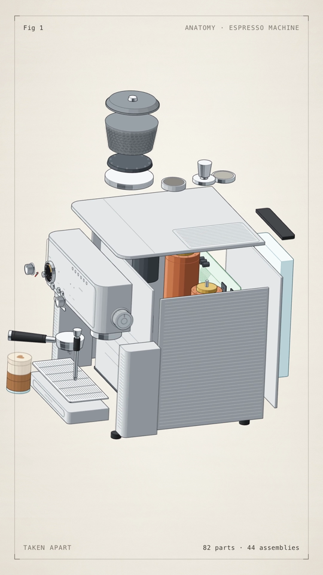
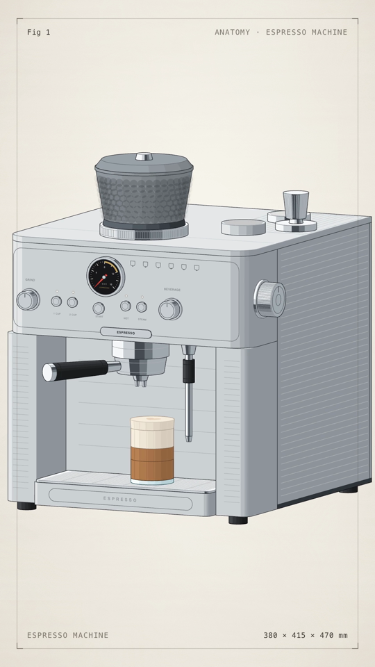

# Anatomy Reveal

An agent skill that builds **any physical object** as a crafted isometric anatomy figure (many small, real, convex parts, ink on paper) and turns it into two things:

1. **An interactive dissection page**: drag to turn it, hover to take it apart, press keys to work its features.
2. **A reveal film**: an MP4 at 30 fps in 9:16 (1080 × 1920, the default), 4:5 (1080 × 1350), 1:1 (1080 × 1080) or 16:9 (1920 × 1080), 10 s by default or any length from 3 to 60 s. The object tumbles in, whips to macro shots of its details, shows a feature working, explodes into its parts and snaps back together, with adaptive motion blur, on a white paper background.

It works from **a photo of the object** or from **just its name**. Espresso machines, headphones, kettles, sneakers, chairs, guitars, bikes, watches, perfume bottles, fruit: the object is always rebuilt from real dimensions as geometry, never traced from a picture.

The included worked example is a dual-boiler espresso machine with a built-in grinder (82 parts): the hopper, gauge and steam knob in macro, the portafilter unlocking, then the shell, boilers, pump and grinder coming apart.

<p>
  
  
</p>

Watch the demo film: [demo/espresso-machine.mp4](demo/espresso-machine.mp4)

## Requirements

- Node.js 20+
- Google Chrome, Chromium or Microsoft Edge. It is found automatically on macOS, Linux and Windows; otherwise set `CHROME_PATH`.
- ffmpeg
- ImageMagick 7 (`magick`)

## Install

Copy this folder into your agent's skills directory, for example:

```sh
git clone https://github.com/annnguyentt/anatomy-reveal-skill ~/.claude/skills/anatomy-reveal
```

Any agent that reads `SKILL.md`-style skills and can run shell commands can use it. Agents without skill support can be pointed at `SKILL.md` directly.

## Use

Ask your agent for things like:

- "Make an anatomy reveal video of a Moka pot."
- "Here's a photo of my sneaker. Dissect it and make a 10-second reveal film."
- "Exploded-view animation of a mechanical keyboard, 8 seconds."
- "A square 1:1 reveal of my espresso machine for Instagram."

## By hand

```sh
node scripts/new-project.mjs my-object
cd my-object
node object/test-page.mjs --light
node object/build.mjs && node object/build.mjs --light
node motion/build.mjs --duration 10 --ratio 1:1
npm run check
npm run render
npm run encode
```

- `node object/test-page.mjs --light` writes the bare test page, `object/test-light.html`.
- `node object/build.mjs` (and `--light`) writes the anatomy page, `object/figure.html` and `object/figure-light.html`.
- `node motion/build.mjs --duration 10 --ratio 1:1` writes the film page, `motion/motion.html`. `--ratio` is `9:16` (default), `4:5`, `1:1` or `16:9`.
- `npm run check` sweeps the explode from five views and every frame for parts passing through each other.
- `npm run render` renders the frames with adaptive motion blur into `out/blur/`.
- `npm run encode` writes `out/film.mp4`.

To make your own object, edit `object/geometry.mjs`, `object/film.mjs` and `motion/timeline.mjs`. `SKILL.md` and `references/` explain how.

## Layout

```
SKILL.md                  the skill: inputs, workflow, rules
references/               inputs, objects, building, shots, look
scripts/new-project.mjs   scaffolds a project from the template
template/                 a complete working project (kit, object, motion)
demo/                     the example's film and two stills
```

## Credit

If you use, remix, fork, or learn from this skill, please give credit:

- **Ann Nguyen** on X: [https://x.com/ann_nnng](https://x.com/ann_nnng)
- I vibe code with **[TypingMind](https://typingmind.com)**, my favourite tool for building with AI

A mention or a link back is enough. Thank you for keeping the credit with the work.

## Licence

MIT. `template/kit/` is from [Anatomy](https://github.com/wheresryan22/anatomy) (MIT); see `THIRD_PARTY_NOTICES.md`.

Product names mentioned in examples belong to their owners. This project is not affiliated with any manufacturer.
